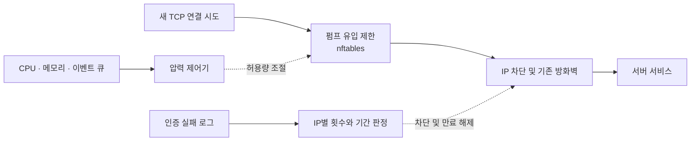

# RotaryShield

**서버의 부하를 읽고, 연결의 유입량을 조절하는 Linux 보안 데몬.**

RotaryShield는 로타리 펌프의 기계적 원리에서 출발한 개인 보안 프로젝트입니다. 서버가 감당할 수 있는 흐름을 유지한다는 목표 아래, 부하에 따라 새 TCP 연결의 허용량을 조절하고 반복된 인증 실패를 감지해 IP를 차단합니다.

현재 개발의 중심은 서버에서 운용하는 **데몬과 CLI**입니다. 펌프 제어기와 로그 기반 차단을 연결한 베타 단계이며, 실제 Linux 환경의 패킷 차단 효과와 정상 사용자에 미치는 영향은 검증이 남아 있습니다.

[설계 의도](#설계-의도) · [빠른 시작](#빠른-시작) · [동작 원리](#동작-원리) · [서버 설정](#서버-설정) · [관리 명령](#관리-명령) · [검증과 한계](#검증과-한계)

## 설계 의도

트래픽이 몰릴 때 서버가 받아들이는 작업량도 함께 늘어나면, 정상적인 요청을 처리할 여유까지 줄어듭니다. RotaryShield는 이때 **얼마나 받아들일지, 언제 제한을 강화할지, 언제 다시 열어줄지**를 제어하려는 시도입니다.

이름의 출발점인 로타리 펌프에서 일정한 양을 이송한다는 발상을 가져왔습니다. 여기에 압력을 관측하고 과부하를 줄이는 제어를 더해 소프트웨어로 옮겼습니다. 펌프와 압력 제어 장치에서 얻은 영감을 소프트웨어 제어 규칙으로 해석한 설계입니다.

| 설계 발상 | RotaryShield의 구현 |
| --- | --- |
| 한 번에 감당할 수 있는 양을 정한다 | IP별·서비스별로 연결 유입 한도와 버스트를 설정 |
| 시스템에 쌓이는 압력을 읽는다 | 호스트 CPU·메모리 사용률과 이벤트 큐 점유율을 관측 |
| 압력이 높아지면 유입을 줄인다 | 정상 → 조절 → 과압 단계로 허용량 축소 |
| 안정된 뒤 흐름을 회복한다 | 낮은 압력이 일정 시간 유지되면 한 단계씩 복귀 |

이 설계의 가치는 앞으로 **부하 상황에서 정상 요청의 성공률과 지연을 얼마나 개선하는지**로 확인하려 합니다. 현재의 구현이나 테스트 결과가 그 효과를 입증한 것은 아닙니다.

## 빠른 시작

### 1. 설치

프로젝트가 선언한 Python 요구 버전은 3.8 이상입니다. 소스를 받은 디렉터리에서 가상 환경을 만들고 설치합니다.

```bash
python3 -m venv .venv
. .venv/bin/activate
python -m pip install -e .
```

서버 데몬과 실제 방화벽 제어는 Linux를 대상으로 합니다. 아래 오프라인 데모는 macOS에서도 확인했습니다. 현재 설치 의존성에는 기존 웹 UI 패키지도 포함되어 있습니다.

### 2. 펌프의 반응 살펴보기

```bash
rotaryshield-pump demo
```

합성 압력 데이터를 넣어 제어기의 반응을 재생합니다. 설정 파일이나 관리자 권한이 필요 없고, 실행 중 외부에 접속하거나 방화벽을 변경하지 않습니다.

```text
보수적으로 시작       안정 후 회복          부하 상승          안정 후 회복
 relief → regulated → nominal → regulated → relief → regulated → nominal
   2          10         20         10          2         10         20
                         제안 한도: SYN/초
```

데모는 변화를 쉽게 볼 수 있도록 회복 시간을 6초로 설정했습니다. 이 출력은 제어 로직의 동작 예시이며, 실제 트래픽을 사용한 성능 측정 결과가 아닙니다.

설치된 의존성을 사용해 소스에서 바로 실행할 수도 있습니다.

```bash
PYTHONPATH=src python3 -m rotaryshield.pump demo
```

### 3. 설정과 생성 규칙 확인하기

```bash
install -m 600 configs/config.example.yml ./config.local.yml

# 설정 구조와 탐지 패턴 검사
rotaryshield --config ./config.local.yml --test-config

# 생성할 nftables 규칙을 화면에 출력
rotaryshield-pump plan --config ./config.local.yml
```

두 명령 모두 방화벽 규칙을 적용하지 않습니다. 설정 검사는 로그 파일의 존재·읽기 권한이나 실제 방화벽 적용 가능 여부까지 확인하지 않으므로, 데몬 기동 준비는 [서버 설정](#서버-설정)을 따릅니다.

## 동작 원리

RotaryShield에는 **서버 압력에 따른 유입 조절**과 **로그 증거에 따른 IP 차단**이라는 두 제어 경로가 있습니다. 아래 그림은 두 경로의 관계를 나타냅니다.



### 압력에 따른 유입 조절

호스트 전체의 CPU·메모리 사용률과 RotaryShield 이벤트 큐 점유율을 0~1 범위로 읽고, 가장 높은 값을 압력으로 삼습니다.

| 단계 | 의미 | 서비스 한도 | SSH 예제 |
| --- | --- | --- | --- |
| `nominal` | 정상 운용 | `rate` | 20 SYN/초 |
| `regulated` | 유입 축소 | `rate`의 절반을 정수로 내림. `minimum_rate` 이상 유지 | 10 SYN/초 |
| `relief` | 과압 대응·보수적 시작 | `minimum_rate` | 2 SYN/초 |

시작 단계는 `relief`입니다. 예제에서는 낮은 압력이 30초 유지되면 `regulated`로, 다시 30초 유지되면 `nominal`로 복귀합니다. 원시 측정값과 평활화한 값이 모두 낮음 기준을 충족해야 회복 시간을 셉니다.

평활화한 압력이 높음 기준에 도달하면 정상 단계에서 조절 단계로 전환합니다. 원시 측정값이 과압 기준에 도달하면 현재 단계와 관계없이 즉시 `relief`로 들어갑니다. 회복 도중 낮음 기준을 벗어나거나 센서 오류·긴 관측 공백이 생기면 회복 시간을 다시 셉니다. 서로 다른 진입·회복 기준을 사용해 단계가 자주 오가는 현상을 줄입니다.

실제 유입 제한에는 시간이 지나며 허용량이 충전되는 **토큰 버킷**을 사용합니다. 서비스 전체 한도는 IPv4와 IPv6가 공유하고, IP별 한도를 함께 적용합니다. `burst`는 한꺼번에 통과시킬 수 있는 양이므로 특정 1초 구간의 통과량이 표의 평균 속도와 같지는 않습니다.

호스트 부하는 서비스 상태의 간접 지표입니다. 다른 작업 때문에 CPU 사용률이 높아져도 제한이 강화될 수 있습니다. 요청 지연이나 서비스의 적정 처리 용량을 자동으로 알아내지는 않으며, 부하 상승만으로 특정 IP를 공격자로 판정하지도 않습니다.

### 로그에 따른 IP 차단

설정한 로그에서 패턴을 찾고, 첫 번째 캡처 그룹을 출발지 IP로 읽습니다. `time_window` 안의 IP별 실패 횟수가 `max_retry`에 도달하면 경고하고, `ban_threshold`에 도달하면 차단합니다. 예제는 SSH 인증 실패를 대상으로 합니다.

차단 엔진은 SQLite에 이벤트와 차단·해제 감사 기록을 저장합니다. 방화벽 명령의 성공 반환을 확인해 DB 상태를 갱신하며, 실패하면 롤백이나 보상 동작을 시도합니다. 약 5초 간격으로 만료된 차단을 해제하고, 실패한 해제는 다음 주기에 재시도합니다. 재기동 시에는 저장된 활성 차단을 복구합니다.

## 서버 설정

전체 설정은 [configs/config.example.yml](configs/config.example.yml)을 기준으로 작성합니다. 서버에는 `/etc/rotaryshield/config.yml`로 배치하며, 파일 권한은 `0600` 또는 `0640`을 사용합니다.

설정 경로는 `--config` → `ROTARYSHIELD_CONFIG` 환경 변수 → `/etc/rotaryshield/config.yml` 순서로 결정합니다.

### 실행 전 준비

| 항목 | 준비할 내용 |
| --- | --- |
| 인증 로그 | 서버에 실제로 존재하고 서비스 계정이 읽을 수 있는 `detection.log_files` |
| 관리용 주소 | `ban.whitelist_ips`에 관리용 IP 또는 CIDR 추가. 루프백은 항상 제외 |
| IP 차단 백엔드 | `ban.firewall_backend`에 `iptables`, `ufw`, `firewalld` 중 사용할 도구 지정. `auto`도 지원 |
| 펌프 적용 | `enforce` 사용 시 `nft` 실행 파일과 방화벽 관리 권한 필요 |
| 저장·실행 경로 | `/var/lib/rotaryshield`, `/var/log/rotaryshield`, `/run/rotaryshield`의 접근 권한 |

활성 차단이 남아 있는 동안에는 차단 백엔드를 바꾸지 않습니다. 비활성 UFW는 초기화에 실패하며, UFW·firewalld는 `CAP_NET_ADMIN` 외에 각 도구가 요구하는 관리 권한도 필요합니다.

### 펌프 모드 선택

| `pump.mode` | 압력 관측·한도 계산 | 펌프 규칙 적용 |
| --- | --- | --- |
| `off` | 중지 | 적용하지 않음 |
| `observe` | 수행 | 제안 한도만 기록 |
| `enforce` | 수행 | nftables로 적용 |

**이 모드는 펌프에만 적용됩니다. 데몬의 로그 기반 IP 차단은 모든 모드에서 동작합니다.** 방화벽 변경 없이 살펴보려면 앞의 `demo`, `plan`, 설정 검사 명령을 사용합니다.

예제는 `observe`로 시작합니다. 기존 설정에 `pump` 항목이 없으면 기본값은 `off`입니다. `off`와 `observe`는 이전 실행에서 남은 펌프 규칙을 지우거나 검사하지 않습니다.

다음은 전체 설정 파일 중 펌프 부분입니다.

```yaml
pump:
  mode: observe
  sample_interval: 2
  low_pressure: 0.50
  high_pressure: 0.75
  relief_pressure: 0.95
  smoothing_seconds: 5
  recovery_seconds: 30
  source_timeout: 60
  max_sources: 4096
  services:
    - name: ssh
      port: 22
      rate: 20
      minimum_rate: 2
      burst: 10
      per_source_rate: 2
      per_source_burst: 4
```

수치는 동작을 설명하기 위한 예시입니다. 서버의 평소 부하와 서비스 용량을 관측해 조정해야 합니다. 예를 들어 메모리 사용률이 항상 `low_pressure`보다 높다면, 시작 후 낮은 압력이 유지되는 조건을 만족하지 못해 한도가 회복되지 않습니다.

`max_sources`는 서비스·주소 계열별로 추적할 IP 상태의 최대 개수입니다. 유휴 상태는 `source_timeout` 뒤 만료되며, 상태 공간이 찼을 때 새로운 주소를 제한 없이 통과시키지 않습니다. 화이트리스트 주소와 루프백은 펌프 한도에서 제외됩니다.

### 데몬 기동

실행 계정의 로그·저장 경로·방화벽 권한을 준비한 Linux 서버에서 실행합니다.

```bash
rotaryshield --config /etc/rotaryshield/config.yml
```

`python -m rotaryshield`도 같은 진입점입니다. 프로세스는 포그라운드에서 실행되며, `--daemon`을 지정해도 자체적으로 포크하지 않습니다.

systemd로 운용할 때는 [서비스 파일](systemd/rotaryshield.service)의 실행 경로, 서비스 계정, 로그 읽기 권한을 설치 환경에 맞춥니다. 가상 환경에 설치했다면 해당 Python 경로를 사용해야 합니다. 서비스는 `Type=simple`이며 설정 변경은 재시작으로 적용합니다. hot reload는 지원하지 않습니다. 기존 `install.sh`의 전역 설치 절차는 Linux 검증이 남아 있습니다.

## 관리 명령

아래 명령은 기본 설정 경로를 사용합니다. 다른 설정을 사용한다면 `--config <경로>`를 덧붙입니다. 서비스 상태·제어와 로그 모니터 명령은 systemd로 등록한 `rotaryshield` 서비스를 대상으로 합니다.

| 목적 | 명령 |
| --- | --- |
| 설정 검사 | `rotaryshield-config --test` |
| 서비스 상태 | `rotaryshield-status` |
| 최근 로그 / 실시간 로그 | `rotaryshield-monitor --lines 20` / `rotaryshield-monitor --follow` |
| 기록된 차단 목록 | `rotaryshield-list-blocked` |
| 차단·이벤트 통계 | `rotaryshield-stats` |
| 지정 IP 차단 해제 | `rotaryshield-unblock 192.0.2.10` |
| 서비스 재시작 / 중지 | `rotaryshield-control restart` / `rotaryshield-control stop` |
| 펌프 상태 / JSON 출력 | `rotaryshield-pump status` / `rotaryshield-pump status --json` |
| 정상 단계의 규칙 미리 보기 | `rotaryshield-pump plan --stage nominal` |

`192.0.2.10`은 예시 주소입니다. 차단 해제에는 실제로 해제할 주소를 지정합니다.

### 상태 읽기

펌프 상태에는 제안 단계인 `desired_stage`와 마지막으로 적용을 확인한 `applied_stage`가 따로 표시됩니다. 관측 모드에서는 적용 단계와 패킷 카운터를 비워 둡니다.

| 카운터 | 의미 |
| --- | --- |
| `passed` | 펌프 제한을 통과한 SYN 패킷 수 |
| `source_dropped` | IP별 제한 경로에서 버린 SYN 패킷 수. 상태 공간 부족 포함 |
| `capacity_dropped` | 서비스 전체 한도 또는 현재 단계 한도로 버린 SYN 패킷 수 |

이 값은 요청 성공 횟수가 아닙니다. `passed`로 집계한 패킷도 이후의 다른 방화벽에서 차단할 수 있습니다. 펌프 상태와 차단 목록은 DB에 저장한 기록을 읽으며, 조회 순간에 방화벽을 검사하지 않습니다. 오래된 펌프 상태는 `STALE`로 표시하고 실패 코드를 반환합니다.

차단 목록의 `expiry pending`은 만료 시간이 지났지만 해제를 완료하지 못한 상태입니다. 수동 해제 명령도 방화벽 해제나 DB 갱신에 실패하면 실패 코드를 반환합니다.

### 종료와 복구

| 상황 | 동작 |
| --- | --- |
| 정상 종료 | 로그 감시를 멈추고 수신한 이벤트를 처리. 적용 모드에서 설치한 펌프 테이블은 제거하고, 활성 IP 차단은 유지 |
| 센서·적용 오류 | `degraded`로 기록하고 다음 주기에 재시도. 확인하지 못한 적용 상태를 성공으로 표시하지 않음 |
| 강제 종료 | 마지막 펌프 한도가 커널에 남을 수 있음 |
| 재기동 | 저장된 IP 차단 복구. 적용 모드에서는 소유 표시를 확인한 펌프 테이블을 보수적인 시작 한도로 교체. 초기화 실패 시 기동 중단 |

강제 종료 후 펌프를 끄거나 관측 모드로 전환하려면 데몬이 멈춘 상태에서 남은 규칙을 정리합니다. 이 명령은 **실제 방화벽을 변경**하며, 기존 IP 차단 규칙은 유지합니다.

```bash
rotaryshield-pump release --config /etc/rotaryshield/config.yml
```

펌프가 사용하는 테이블은 `inet rotaryshield_pump`입니다. 소유 표시가 없는 동명의 테이블은 변경하지 않으며, `/run/rotaryshield/pump.lock`으로 실행 중인 적용 제어기와의 충돌을 막습니다. 다른 방화벽 관리자가 전체 ruleset을 초기화하는 환경에서는 함께 운용할 수 있는지 확인해야 합니다.

## 검증과 한계

### 확인한 범위

2026-10-16 로컬 검증에서 기본 동작 21개와 펌프 31개, **총 52개 테스트**를 통과했습니다. 아래 두 테스트 모음의 결과이며, 저장소 전체 테스트나 운영 환경 검증 결과는 아닙니다.

```bash
PYTHONPATH=src python3 -m unittest tests.unit.test_runtime_basics tests.unit.test_pump -v
```

검사는 임시 SQLite, 합성 인증 로그·압력, 가짜 방화벽, 모의 nft 호출을 사용합니다. 로그에서 차단까지의 흐름, 만료·복구, 압력 단계 전환, 회복 조건, 적용 실패와 종료 처리를 다룹니다. 실제 시스템 방화벽이나 외부 서버를 조작하지 않습니다.

현재 macOS 개발 환경에서는 Linux 커널의 nft 구문 검사와 실제 패킷 차단 효과를 검증하지 못했습니다. `enforce`는 기동 시 `nft --check`를 통과해야 규칙을 적용하지만, 이 검사만으로 서비스 보호 효과를 입증할 수는 없습니다.

다음 검증은 외부·호스트·LAN 통신이 차단된 Linux 실험실에서 IPv4/IPv6 유입 제한, 정상 연결의 성공률·지연, 과압과 회복, 강제 종료·재기동을 측정하는 것입니다. 배포판별 방화벽과 systemd 권한도 확인 대상입니다.

### 적용 범위

- **호스트 INPUT 경로의 새 TCP SYN을 제어합니다.** 재전송 SYN도 집계합니다. 이미 연결된 세션 안의 HTTP 요청이나 SSH 로그인 시도, UDP/QUIC, 컨테이너의 FORWARD 경로는 펌프 제한 대상에 포함되지 않습니다.
- **IP별 한도는 같은 주소를 공유하는 사용자에게 함께 적용됩니다.** NAT 환경이나 다수 주소를 사용하는 공격에서 정상 사용자의 몫을 보장하는 기능은 없습니다. 회선 포화 방어 효과도 검증하지 않았습니다.
- **정규식은 신뢰할 수 있는 패턴을 사용해야 합니다.** 현재 복잡도 검사와 스레드 대기 제한이 모든 ReDoS를 막지는 못합니다.
- **기존 웹 UI는 인증·DB 연동 문제를 정비하기 전까지 외부에 노출하지 않습니다.** 현재 사용 경로는 데몬과 CLI입니다.

알림 전송, 자동 DB 백업, 반복 차단에 따른 시간 증가, honeypot은 현재 데몬에서 실행되지 않습니다. 이전 `throttling.ssh_delay`, `throttling.http_rate_limit` 등은 호환용 설정이며 실제 트래픽을 제어하지 않습니다. 연결 제한은 `pump`에서 설정합니다.

이전 설정의 `blocking.firewall`, `detection.thresholds.warning/blocking`은 호환됩니다. 새 설정에는 `ban.firewall_backend`, `detection.max_retry`, `detection.ban_threshold`를 사용하며, `ban`과 `blocking`을 동시에 선언하면 오류로 처리합니다.

## 코드 구조

```text
src/rotaryshield/
├── main.py                   # 데몬 기동과 종료
├── cli/commands.py           # 서비스·로그·차단 관리 CLI
├── pump/
│   ├── controller.py         # 압력 판정과 단계 전환
│   ├── nftables.py           # 유입 제한 규칙 생성·적용·정리
│   ├── runtime.py            # 호스트 측정과 상태 저장
│   ├── simulation.py         # 오프라인 압력 재생
│   └── __main__.py           # demo / plan / status / release
├── security/engine.py        # 로그 이벤트 처리와 구성 요소 연결
├── security/bans.py          # 차단·해제와 DB 상태 조정
├── monitoring/               # 로그 감시와 패턴 매칭
├── firewall/                 # iptables / ufw / firewalld 어댑터
├── database/                 # SQLite 저장소
└── dashboard/                # 기존 웹 UI
```

기존 `cli.py`, `monitor_service.py`, 루트의 `dashboard/`와 `archive/`도 보존되어 있습니다. 이 README의 데몬 진입점은 `rotaryshield.main`입니다.

## 참고와 기여

규칙 구현은 Netfilter의 [IP별 동적 제한](https://wiki.nftables.org/wiki-nftables/index.php/Meters), [토큰 버킷과 체인 제어](https://netfilter.org/projects/nftables/manpage.html), [원자적 규칙 교체](https://wiki.nftables.org/wiki-nftables/index.php/Atomic_rule_replacement)를 참고했습니다.

문제를 보고할 때는 재현 절차, 실행 모드, OS·Python·방화벽 버전과 민감 정보를 제거한 설정·로그를 함께 남겨 주세요. 실제 방화벽을 사용하는 실험 결과에는 격리 환경과 정상 연결에 미친 영향도 적어 주시면 도움이 됩니다. 기존 공격 테스트나 설치 스크립트는 내용을 확인한 뒤 실행해 주세요.

프로젝트 저장소: [sangwon0707/rotaryshield](https://github.com/sangwon0707/rotaryshield)

라이선스 선언은 정리가 필요합니다. 현재 패키지 메타데이터는 MIT를 표시하지만, 기존 README에는 미정으로 적혀 있었으며 독립된 `LICENSE` 파일은 없습니다.
